## 🕷️ About Me

I'm a BSc (Hons) Information Technology undergraduate at **SLIIT**, focused on **AI-powered real-time systems** and high-performance applications. I like turning ideas into working products, from the model to the interface.

- 🔭 Working on AI-powered systems with Qwen, LoRA / QLoRA and FastAPI
- 🎮 Love 3D and visual work with Three.js and Blender
- 🌱 Always learning: LLMs, computer vision, real-time apps
- 📫 Reach me: **piumal89001@gmail.com**

## 🕸️ Tech Stack

**Languages**

**Frontend**

**Backend & Databases**

**AI / ML**

**Tools**

## 📊 GitHub Stats

## 🤝 Let's Connect

Open to internships, collaborations and AI / full-stack projects. Drop me an email or a message.

